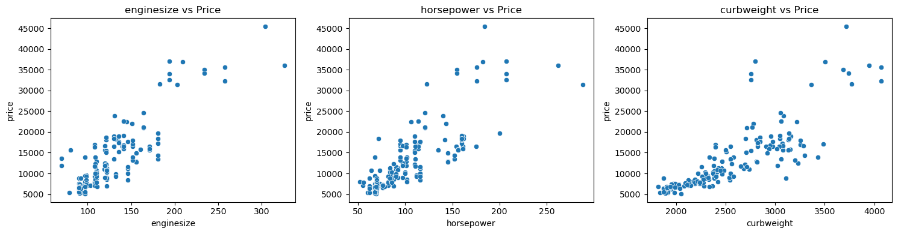
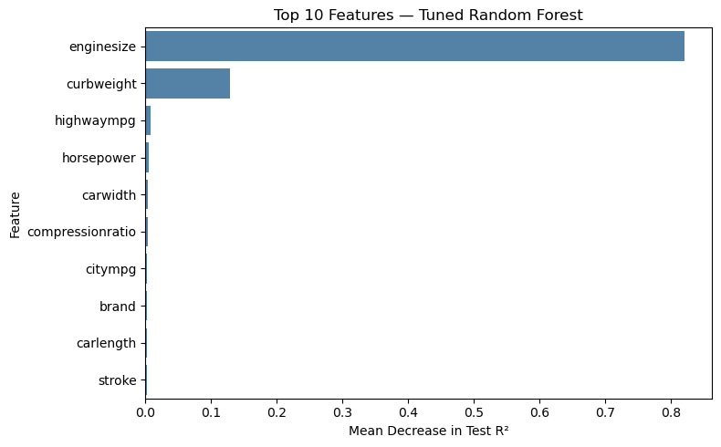

# Car Price Analysis and Prediction

Exploring vehicle pricing patterns with Python, then comparing regression models to estimate car prices.

**Focus:** data cleaning · exploratory data analysis · visualization · model evaluation

## Business question

Which vehicle specifications are associated with higher prices, and how well can those specifications predict price in this dataset? The course brief considers a car manufacturer's potential US market entry. This is an educational analysis of a historical sample, rather than research commissioned by a manufacturer.

## Key findings

- The training price distribution is right-skewed, with most observations approximately between 5,000 and 20,000 in the dataset's price units.
- Engine size, curb weight, and horsepower show positive relationships with price in the training-data visualizations.
- Brand and body-type price distributions differ, but some categories contain very few observations.
- Engine size and curb weight contribute most strongly to the fitted Random Forest's permutation importance. These are predictive associations; they do not establish causal effects.



## Dataset

- Included file: [`CarPrice_Assignment.csv`](CarPrice_Assignment.csv)
- 205 records; target: `price`
- 164 training records and 41 test records, using an 80/20 split with `random_state=42`
- Course-provided car-pricing dataset. The original publisher and redistribution terms were not recorded with the supplied file; verify the original source before reusing it outside this educational project.

## Analysis workflow

1. Inspect types, missing values, and duplicate rows.
2. Extract a brand from `CarName` and standardize spelling variations.
3. Remove `car_ID` and the original `CarName` from model inputs.
4. Reserve a test set and conduct EDA on the training data.
5. Encode categorical variables inside pipelines; scale numerical variables for Linear Regression and SVR.
6. Compare five regressors using five-fold training-set cross-validation.
7. Tune Random Forest using GridSearchCV, then evaluate on the held-out test set.
8. Interpret permutation importance and discuss limitations.

## Recorded model results

Random Forest had the highest initial mean cross-validation R² (0.8899). Tuning increased it to 0.8924.

| Model | Test R² | Test MAE | Test MSE |
|---|---:|---:|---:|
| Tuned Random Forest | 0.959 | 1,259.545 | 3,233,542.350 |
| Random Forest | 0.957 | 1,309.480 | 3,416,471.336 |
| Gradient Boosting | 0.928 | 1,666.640 | 5,684,860.239 |
| Decision Tree | 0.906 | 1,787.654 | 7,406,866.582 |
| Linear Regression | 0.901 | 1,807.704 | 7,808,716.036 |
| SVR | 0.895 | 1,889.322 | 8,295,325.092 |

MAE is in the target's price units; R² is a regression score, not classification accuracy.

Selected Random Forest parameters: `n_estimators=200`, `max_depth=10`, `min_samples_leaf=1`.



## Run locally

Use Python 3.10 or newer. Open a terminal in the repository folder:

```bash
python -m venv .venv
# Windows: .venv\Scripts\activate
# macOS/Linux: source .venv/bin/activate
python -m pip install -r requirements.txt
python -m jupyter notebook Car_Price_Prediction.ipynb
```

Select the environment containing the dependencies and run the notebook from top to bottom. The CSV is loaded with a relative path, so no personal drive path is required. Package versions are not pinned; use the recorded environment or check compatibility if results differ.

## Files

| File | Purpose |
|---|---|
| [`Car_Price_Prediction.ipynb`](Car_Price_Prediction.ipynb) | Analysis, model comparison, and interpretation |
| [`CarPrice_Assignment.csv`](CarPrice_Assignment.csv) | Course-supplied dataset |
| [`images/`](images/) | Figures exported from the notebook's existing outputs |
| [`requirements.txt`](requirements.txt) | Packages for running the notebook |

## Limitations and next steps

The dataset is small and historical, with only 41 test records. Results can vary across splits and do not establish present-day US market prices. Related vehicle models may also be shared across a random split. Validate on larger, more recent data and evaluate grouped splits before drawing operational pricing conclusions.

## Background

Developed during Data Science training at Entri. This repository presents practical work in cleaning, exploring, visualizing, and modelling data.
